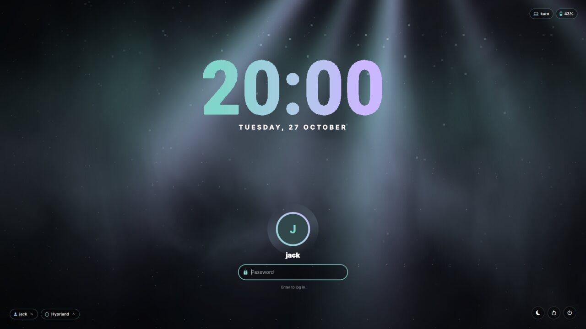
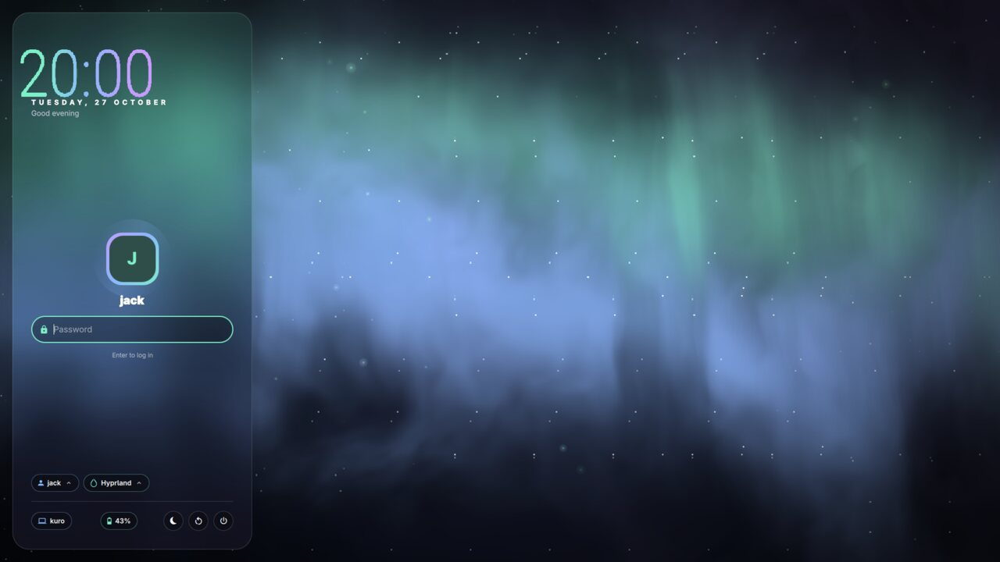
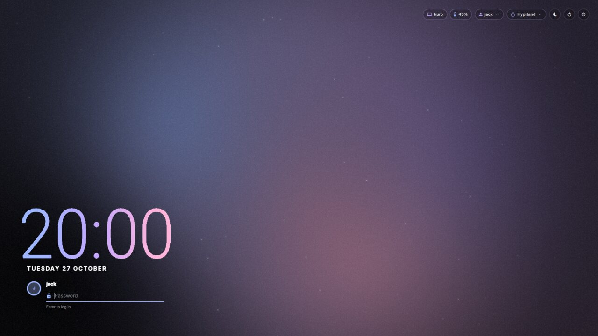
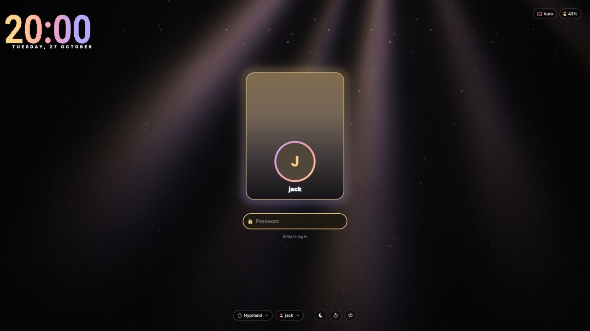
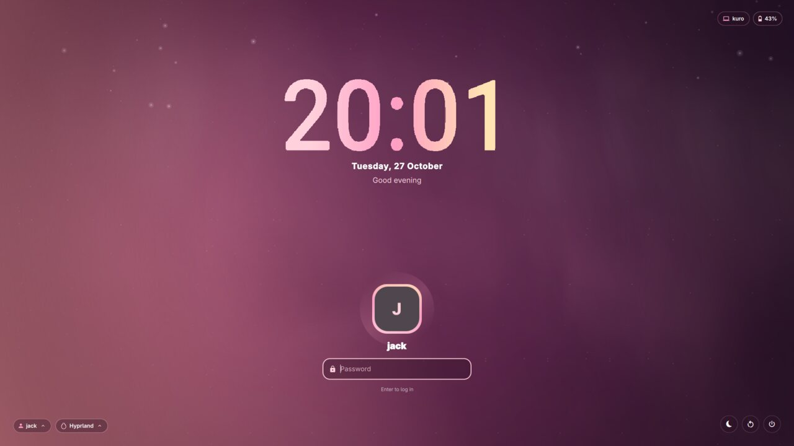
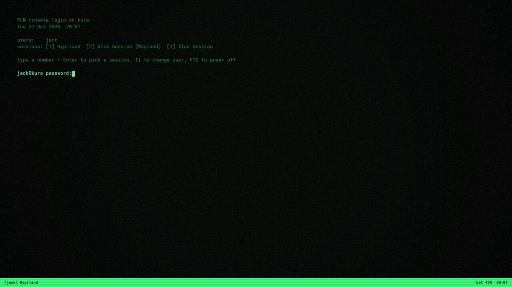
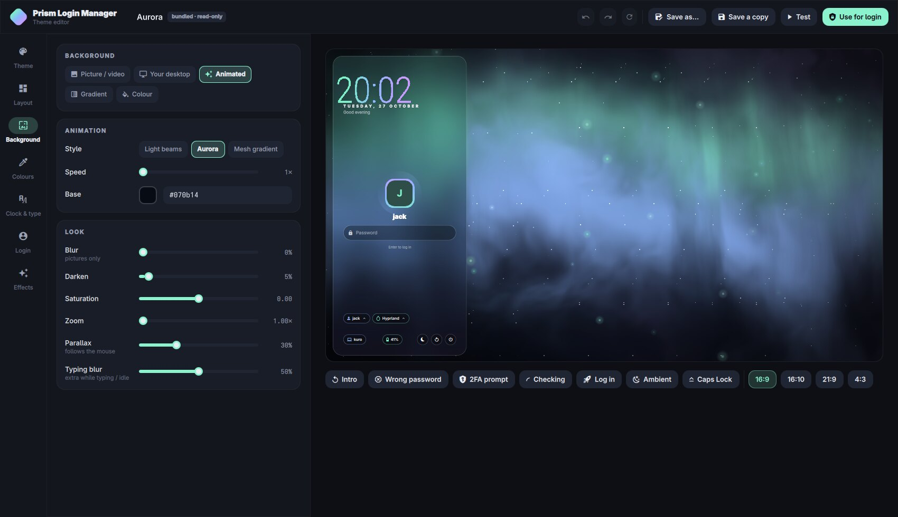

# Prism Login Manager

**A login screen for Linux, built on [Quickshell](https://quickshell.org) and greetd.** It has
themes, a live theme editor and live wallpapers, and it can follow your desktop's look.

<p align="center">
  
</p>

PLM (Prism Login Manager) does what SDDM does, the Quickshell way. You pick a theme, or design one in
the editor while the real login screen updates next to you. Backgrounds can be pictures, GIFs,
**live video wallpapers** or animated shaders. If you use the [Prism shell](https://github.com/Jack02134x/prism-shell),
PLM can follow it: your wallpaper, live ones included, plus your colours and avatar appear at the login
screen. Each person sees their own.

PLM works on its own and doesn't need Prism.

## Themes

| | |
| :---: | :---: |
|  |  |
| **Prism**: the Prism lock screen. Follows your desktop after `plm sync`. | **Aurora**: a frosted side panel over northern lights. |
|  |  |
| **Midnight**: a corner clock, one line to type on, stars. | **Cinema**: 3D cards, each showing its user's own desktop. |
|  |  |
| **Bloom**: pink dusk with soft light drifting down. | **Terminal**: a phosphor console, written as a custom QML theme. |

## The editor



`plm editor` opens every theme setting on the left, with the real login screen on the right. Changes
show up immediately. Buttons under the preview act out the moments a theme has to handle: a wrong
password (the field shakes), a 2FA prompt, checking, logging in (the outro), ambient mode and Caps
Lock. You can also preview other screen shapes (16:10, 21:9, 4:3).

- **Theme**: name, author and description; open any theme on the system.
- **Layout**: Prism, Glass, Minimal, Coverflow or custom QML; panel side, width, frost and tint; what
  to show (user and session pickers, power buttons, battery, Caps Lock, hostname, hints).
- **Background**: picture, GIF or video (from a file, or a gallery of your wallpapers), your synced
  desktop, an animated shader (light beams, aurora, mesh gradient), a gradient or a colour. Then blur,
  darken, saturation, zoom, mouse parallax and extra blur while typing.
- **Colours**: accents from your Prism palette, from the wallpaper, or picked by hand (an HSV picker
  with quick picks), plus text, surfaces, outlines and errors.
- **Clock & type**: time and date formats, size, weight, gradient fill, greeting, and any installed font.
- **Login**: avatar size, shape and ring; field style (glass, solid, underline), size, placeholder,
  and the character used for password dots.
- **Effects**: snow, fireflies, stars, embers or rain; an aurora overlay, vignette, film grain and
  glow; how the screen appears (rise, zoom, fade, unblur) and leaves; ambient mode.

Undo and redo keep a full history (`Ctrl+Z` and `Ctrl+Shift+Z`). Bundled themes are read-only, so
saving one makes your own copy in `~/.local/share/plm/themes`. **Test** opens your theme full-screen
in test mode. **Use for login** installs it system-wide and makes it the login screen (it asks for
your password).

## Features

- **Live wallpapers**: mp4, webm, mkv and mov play on a loop with no sound. Qt Multimedia decodes them
  on the GPU where the driver supports it. A poster frame shows until the first frame arrives, and
  colours can come from the video itself.
- **Your desktop at login**: `plm sync` copies your Prism wallpaper, live or static, along with its
  palette and your avatar. Without Prism, run `plm sync --wallpaper FILE`. `plm sync --auto` keeps it
  up to date whenever the wallpaper changes. When you pick another user at the login screen, the
  background cross-fades to theirs.
- **Every state handled**: wrong password (a shake), extra PAM prompts such as an OTP, checking,
  Caps Lock, an unlisted user name ("Someone else…"), and a session that fails to start.
- **Ambient mode**: after a while with no input, everything except the clock fades out. Any key brings
  it back, and the key you pressed goes into the field.
- **Several monitors**: the background and clock show on every monitor. Click a monitor to move the
  login box there.
- **Sessions**: every Wayland session, plus X11 sessions through `startx`. PLM remembers each user's
  last session and the last user.
- **Power**: sleep, restart and shut down. The first click arms a button and the second one runs it,
  so a stray click does nothing.
- **Custom QML themes**: a theme can ship its own `Main.qml` and build anything, like SDDM themes.
  See [Custom layouts](#custom-layouts-qml).
- **Test mode**: run the whole login screen in a window. Nothing logs in and nothing powers off.

## Requirements

- **greetd** and **Quickshell** (built with greetd support; Arch's `quickshell` package has it).
- A small compositor for the login screen to run in: **Hyprland**, **sway** or **cage**.
- **qt6-multimedia** with **qt6-multimedia-ffmpeg** for video wallpapers.
- Symbols Nerd Font (icons), Adwaita Sans and Roboto (the default fonts), jq or python for
  `plm-session`, and python for the `plm` command.
- Optional: ffmpegthumbnailer or imagemagick (poster frames and thumbnails), zenity (the editor's
  file picker).

## Install

```sh
git clone https://github.com/Jack02134x/prism-login-manager
cd prism-login-manager
./install.sh
```

It asks before each step, and pressing Enter takes the default:

| Step | What happens |
| --- | --- |
| **Packages** | On Arch, installs what's missing in one `pacman` transaction. It adds `cage` only if you have no compositor PLM can use. |
| **Files** | `make install`: `plm` and `plm-session` go in `/usr/bin`, everything else in `/usr/share/plm`. |
| **Login screen** | `plm setup`: makes sure the `greeter` user exists, creates `/etc/plm/plm.json` (with your keyboard layout) and `/var/lib/plm`, and points greetd at `plm-session`. Any old greetd config is backed up first. |
| **Switch** | Only if you say yes (the default is no): disables your current display manager and enables greetd, from the next boot. Try `plm test` first. |
| **Your wallpaper** | If you use Prism: syncs your desktop and offers to keep following it. |

Options: `--yes` takes every default but never switches the login screen on by itself; add `--enable`
for that. Also `--dry-run`, `--no-packages`, `--no-setup`, `--no-sync`, `--prefix DIR` and
`--uninstall`.

To switch later, run `sudo plm setup --enable`. To go back, run `./install.sh --uninstall`: it
re-enables the display manager you had and restores the old greetd config.

## Try it

```sh
plm test                     # the login screen in a window
plm test --theme midnight    # another theme
plm test --fullscreen        # full screen (Ctrl+Q leaves)
```

In test mode any password "logs in": the screen plays its outro and says what it would have started.
`fail` counts as a wrong password and `2fa` asks for a code. F5 reloads the theme, and the window
reloads by itself when `theme.json` changes, so you can also edit the JSON directly.

## Making themes

The easiest way is `plm editor`. A theme is just a folder:

```
mytheme/
  theme.json      settings (everything below is optional)
  Main.qml        only for "layout": "custom"
  assets/         pictures and videos it uses
```

Themes are looked up by folder name in `~/.local/share/plm/themes`, then `/etc/plm/themes` (installed), then `/usr/share/plm/themes` (bundled).

```jsonc
{
    "name": "My theme",
    "author": "me",
    "layout": "prism",              // prism | glass | minimal | coverflow | custom
    "background": {
        "type": "media",            // media | prism | shader | gradient | color
        "source": "assets/loop.mp4",// picture, gif or video; relative to the theme, absolute, or ~/
        "fallback": "assets/loop.jpg", // poster for videos (also used for colours)
        "fill": "crop",             // crop | fit | stretch
        "speed": 1, "loop": true,
        "shader": "prism",          // prism | aurora | mesh   (type "shader")
        "colors": ["#10131c", "#24163a", "#0b2730"], // gradient / colour / shader base
        "angle": 135,
        "blur": 0, "dim": 0.2, "saturation": 0, "zoom": 1.0, "parallax": 0.5, "focusBlur": 0.5
    },
    "colors": {
        "source": "auto",           // auto | prism | wallpaper | custom
        "accent": "#82d5ca", "accent2": "#aecae6", "accent3": "#cbb7ff",
        "text": "#ffffff", "textDim": "#ccd0da",
        "surface": "#000000", "surfaceAlpha": 0.36, "border": 0.16, "error": "#ff8a80"
    },
    "fonts": { "ui": "Adwaita Sans", "display": "Roboto", "mono": "Adwaita Mono" },
    "clock": { "show": true, "format": "HH:mm", "dateFormat": "dddd, d MMMM", "size": 200,
               "weight": 900, "gradient": true, "uppercaseDate": true, "dateSpacing": 6, "greeting": false },
    "panel": { "side": "left", "width": 440, "radius": 28, "blur": 0.9, "opacity": 0.42, "border": true },
    "avatar": { "show": true, "size": 112, "shape": "circle", "ring": "gradient", "ringWidth": 4, "spin": true },
    "input": { "width": 360, "height": 52, "radius": 26, "style": "glass", "placeholder": "Password", "mask": "●" },
    "effects": { "aurora": 0, "particles": "none", "particleCount": 80, "vignette": 0.45, "grain": 0,
                 "intro": "rise", "introMs": 1100, "outro": "zoom", "ambientAfter": -1, "glow": true },
    "show": { "users": true, "sessions": true, "power": true, "battery": true,
              "capsLock": true, "hostname": true, "hints": true }
}
```

`"type": "prism"` shows the selected user's synced desktop. If that user hasn't synced, it falls back
to the theme's own `source`, or to its shader.

Useful commands:

```sh
plm theme new "My theme" --from aurora     # start from a copy
plm theme export mytheme mytheme.tar.gz    # share it (pictures and videos are bundled in)
plm theme import mytheme.tar.gz
sudo plm theme install ~/.local/share/plm/themes/mytheme --activate
sudo plm theme set aurora
```

### Custom layouts (QML)

With `"layout": "custom"`, PLM loads the theme's `Main.qml` and gives it one property, `plm`:

| | |
| --- | --- |
| `plm.auth` | `user`, `session`, `phase` (`idle`, `busy`, `prompt`, `launching`), `prompt`, `echo`, `error`, `info`; `submit(text)`, `selectUser(name)`, `cycleUser(±1)`, `selectSession(id)`, `cycleSession(±1)`, `cancel()`; signals `failed(message)` and `launching()` |
| `plm.users` | `list` of `{ name, real, uid, avatar }`, `displayName(name)` |
| `plm.sessions` | `list` of `{ id, name, type, comment }`, `find(id)` |
| `plm.power` | `actions` (`{ id, label, icon }`), `run(id)`, `hasBattery`, `percent` |
| `plm.keyboard` | `capsLock`, `hostname` |
| `plm.theme` | the resolved theme: `accent1`…`accent3`, `text`, `textDim`, `error`, `font`, `display`, `mono`, `data`, `get("clock.size")` |
| `plm.activity` | `poke()`: call it on key presses so ambient mode stays away |
| `plm.view`, `plm.backdrop` | the screen (`reveal`, `ambientT`) and the background item (for your own blur) |
| `plm.clock`, `plm.loginBox`, `plm.userMenu`, `plm.sessionMenu`, `plm.powerButtons`, `plm.statusChips`, `plm.avatar`, `plm.inputField`, `plm.glass`, `plm.chip` | PLM's own pieces as Components, for a `Loader` |

Define `focusField()` and a `typing` property so PLM can focus your field and blur the background
while someone types. Import only Qt modules; PLM's own modules aren't visible from theme folders.
[`themes/terminal/Main.qml`](themes/terminal/Main.qml) is a complete example.

## With the Prism shell

```sh
plm sync          # copy your wallpaper (static or live), colours and avatar now
plm sync --auto   # and again whenever Prism's wallpaper changes (a systemd user path unit)
```

For live wallpapers, `plm sync` copies the copy Prism already made at your screen's resolution, which
is much smaller than a 4K original. It also makes a poster frame for the login screen to show while
the video starts. The synced files live in `/var/lib/plm/users/<you>/`, a folder only you can write to
and the greeter can read.

The **Prism** and **Cinema** themes use it out of the box. In any theme, set the background to
"Your desktop" and the colours to "Prism palette" or "Automatic".

Without Prism: `plm sync --wallpaper ~/Videos/rain.mp4 --avatar ~/me.png`.

## Settings

System-wide settings are in `/etc/plm/plm.json`. View them with `plm config`, and change them with
`sudo plm config KEY VALUE` (for example `sudo plm config ambientAfter 60`).

| Key | Default | |
| --- | --- | --- |
| `theme` | `prism` | the login theme |
| `compositor` | `auto` | `Hyprland`, `sway` or `cage` (`auto` takes the first one installed) |
| `keyboard.layout`, `.variant`, `.options`, `.numlock` | from `localectl` | the keyboard at the login screen |
| `monitor` | `""` | which monitor shows the login box (empty means the first one) |
| `defaultUser`, `defaultSession` | `""` | used before anyone has logged in |
| `remember` | `true` | pre-select the last user, and each user's last session |
| `users.showList`, `users.hidden`, `users.allowOther` | `true`, `[]`, `true` | the user picker |
| `sessions.hidden`, `sessions.shell`, `sessions.extra` | `[]`, `false`, `[]` | hide sessions, add "Console", add your own `{ "name", "exec", "type" }` |
| `power.suspend`, `.hibernate`, `.reboot`, `.poweroff` | on, off, on, on | which power buttons appear |
| `clock24h` | `true` | turns `HH:mm` into `h:mm` |
| `ambientAfter` | `45` | seconds before ambient mode (`0` turns it off); a theme can override it |
| `prismSync` | `true` | let themes show each user's synced desktop |
| `env` | `[]` | extra `KEY=value` for every session |

Monitor layouts and other compositor settings for the login screen go in `/etc/plm/hyprland.lua`
(or `/etc/plm/sway.conf`). PLM loads that file after its own.

## How it works

```
greetd ── runs ──▶ plm-session (as the greeter user)
                     └─▶ Hyprland / sway / cage, with PLM's own minimal config
                           └─▶ quickshell -p /usr/share/plm/shell   (PLM_MODE=greeter)
                                 ├─ one full-screen layer surface per monitor
                                 └─ Quickshell.Services.Greetd ─▶ greetd: PAM, then the session
```

After a successful login, PLM plays its outro and asks greetd to start the session. Then it quits,
which closes its compositor, and greetd starts the session on the same VT. Nothing in your own
Hyprland config is used or changed.

The same Quickshell config also runs `plm test` (a window with mock authentication) and `plm editor`
(the editor, with the real login screen inside as its preview).

## Troubleshooting

- **Check the setup:** `plm doctor` checks packages, greetd, the greeter user, folders, the active
  theme, and whether the greeter's Hyprland config is valid.
- **Black screen or a bounce back to the console:** switch to tty2 (Ctrl+Alt+F2), log in, and read
  `/run/user/$(id -u greeter)/plm-session.log` and greetd's journal (`journalctl -u greetd -b`).
  Switching back is `sudo systemctl disable greetd`, then enable your old display manager.
- **A video background stays on its poster:** install `qt6-multimedia-ffmpeg`. Very large videos can
  be slow to start; `plm sync` uses Prism's screen-sized copy for this reason.
- **No avatar:** run `plm sync` (it copies yours into `/var/lib/plm`). Home folders usually aren't
  readable by the greeter, so `~/.face` alone isn't enough.
- **Wrong keyboard layout at login:** `sudo plm config keyboard.layout de` (for example).

## Development

Run it from the repository without installing anything: `bin/plm test` and `bin/plm editor` use the
checkout. `make shaders` recompiles the shaders, `make icons` regenerates the icon table from the
glyph names used in the QML, and `make check` runs the syntax checks and validates the greeter's
Hyprland config.

## Credits

Built on [Quickshell](https://quickshell.org) and [greetd](https://sr.ht/~kennylevinsen/greetd/).
The look, widgets and aurora shader come from the [Prism shell](https://github.com/Jack02134x/prism-shell).
Icons are Material Design Icons from Nerd Fonts.

PLM was designed by [Jack02134x](https://github.com/Jack02134x). Much of the code was written
together with **Claude** (Anthropic's AI model) in [Claude Code](https://claude.com/claude-code).
